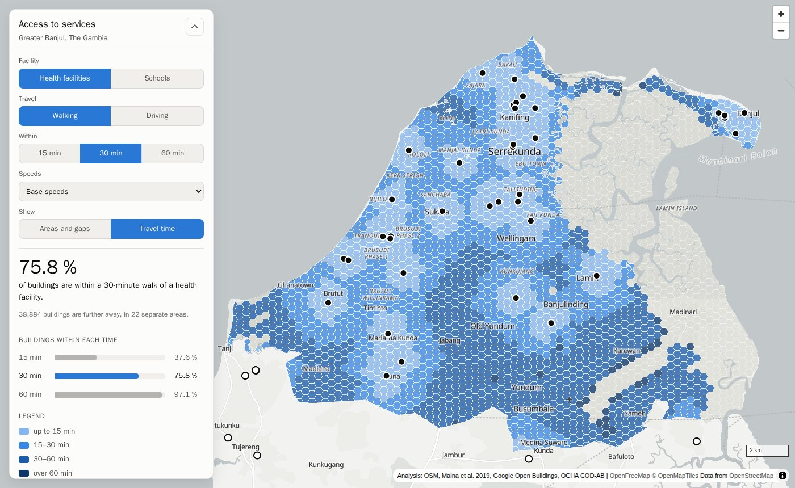
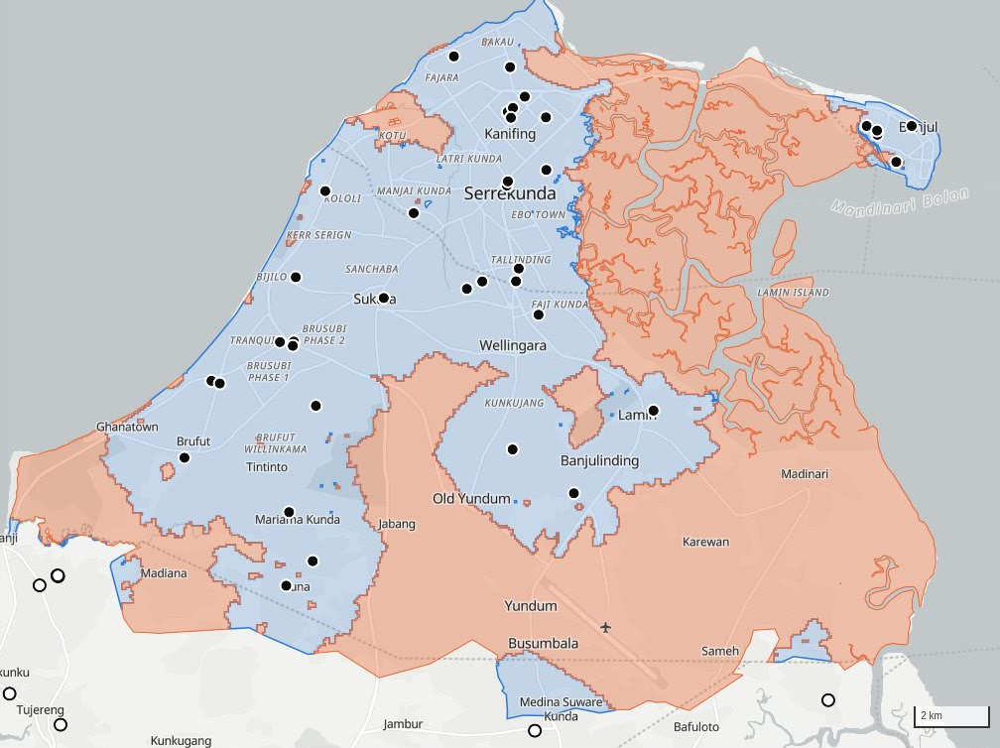
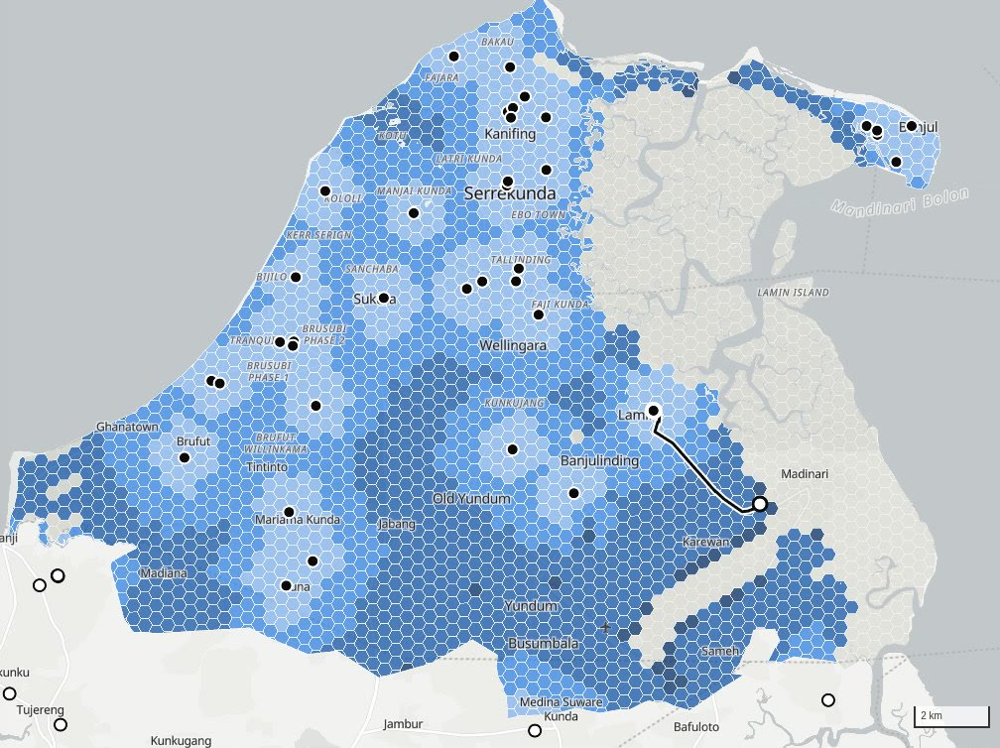

# Access to Services in Greater Banjul — Spatial Analysis and API

How long does it take to walk or drive to the nearest health facility or school in Greater Banjul, The Gambia, and which areas are left out?

This project builds the answer with **PostgreSQL + PostGIS + pgRouting**, serves it through a documented **REST API (FastAPI, GeoJSON)** and shows it on a **web map (MapLibre)**. Everything runs with one `docker compose up`.

**Live demo (static, pre-computed results):** https://motamba.github.io/Service_Accessibility_Analysis_and_Spatial_API/  ·  [API reference](https://motamba.github.io/Service_Accessibility_Analysis_and_Spatial_API/api-docs.html)

**Summary (one page):** [docs/summary.pdf](docs/summary.pdf)  ·  **20-second demo:** [docs/media/demo.mp4](docs/media/demo.mp4)



> **Status:** completed personal portfolio project (November 2026).
> Results are **indicative estimates based on OpenStreetMap data** and must not be used for real planning or emergency decisions.

---

## Quick start

Requirements: Docker with Docker Compose, about 3 GB of disk space and an internet connection for the first run.

On Linux the data-pipeline container writes to `./data` as user id 1000 (the default first user). If `id -u` shows a different number, copy `.env.example` to `.env` and set `HOST_UID` and `HOST_GID` to the output of `id -u` and `id -g`.

```bash
git clone <repo-url> && cd service-accessibility-api-greater-banjul
docker compose up --build
```

The first run downloads the data (about 220 MB) and builds the database, which takes about 15 minutes (tested on a fresh clone: 14 min 42 s). Later runs skip finished steps and start in about a minute. The API starts once the data pipeline has finished.

| What | Where |
|---|---|
| **Web map** | http://localhost:8080 |
| API documentation (try the endpoints in the browser) | http://localhost:8000/docs |
| API | http://localhost:8000 |
| Database (QGIS, `psql`) | `localhost:5433`, database `gis`, user `gis`, password `gis` |

Ports and passwords can be changed in `.env` (see `.env.example`).

Useful commands:

```bash
docker compose run --rm etl make status   # import counts so far
docker compose run --rm etl make reset    # forget finished steps, rebuild on next run
docker compose down -v                    # remove containers and the database volume
```

---

## Study area

**Greater Banjul** is defined as the union of these admin-2 units from the OCHA COD-AB boundaries (valid on 1 Sep 2022):

| LGA | Units (p-code) |
|---|---|
| Banjul City Council | Banjul Central (GM0101), Banjul North (GM0102), Banjul South (GM0103) |
| Kanifing Municipal Council | Bakau (GM0501), Jeshwang (GM0502), Mangrove (GM0503), Sere Kunda Central (GM0504), Sere Kunda East (GM0505), Sere Kunda West (GM0506) |
| Brikama LGA (part) | Kombo North/St Marie (GM0308) |

Total area 283.4 km², of which 271.5 km² is land after removing OSM water areas (rivers and creeks such as the Gambia River estuary and Mandina Ba Bolong). Mangrove wetlands (Tanbi) are kept as land; because they are largely uninhabited, gap results are reported mainly as **numbers of buildings**, not only as area. Roads and facilities are loaded for the study area **plus a 5 km buffer**, so that facilities just outside the boundary still count for people inside it. Results are reported for the study area only. The list of units is in [`etl/config/study_area.env`](etl/config/study_area.env).

---

## Assumptions

Travel times use simple, fixed speeds. They describe free-flowing conditions, not real traffic.

| Item | Value |
|---|---|
| Walking speed | 4.5 km/h on every road and path |
| Driving speeds by OSM `highway` class (km/h) | trunk 60 · primary 50 · secondary 40 · tertiary 30 · unclassified / residential / living_street / road 20 · service 15 · track 10 · links 25–40 · footway, path, pedestrian, steps, cycleway, bridleway: no driving |
| One-way streets | Respected for driving, ignored for walking |
| Ferries | Excluded |
| Disconnected road fragments | Only the main connected network is used: for driving, the largest *strongly* connected part (every node can both reach and be reached) |
| Measuring CRS | WGS 84 / UTM zone 28N (EPSG:32628) |

Speeds are in [`etl/config/speeds.csv`](etl/config/speeds.csv). The sensitivity scenarios in [`etl/config/scenarios.csv`](etl/config/scenarios.csv) re-run the analysis with walking at 4.0 and 5.0 km/h, and with all driving speeds × 0.6 as a simple congestion proxy.

---

## Facilities

| Type | What counts | Source |
|---|---|---|
| Health | OSM `amenity` = hospital, clinic, doctors, or `healthcare` = hospital, clinic, centre, doctor. Pharmacies, dentists and other specialists are not counted. | OpenStreetMap, plus public facilities from Maina et al. (2019) |
| School | OSM `amenity=school`. Kindergartens, colleges and universities are not counted. | OpenStreetMap |

How the facility layer is built:

- A facility mapped as an area becomes a point with `ST_PointOnSurface`. A point of the same type within 50 m of an area is treated as the same facility.
- **OpenStreetMap alone misses many public health centres** in Greater Banjul (e.g. Bakau, Banjul Polyclinic, Brufut, Leman Street). They are added from the Maina et al. (2019) list of public health facilities.
- Maina coordinates are geocoded and can be 0.5–2 km off, so the two sources are matched **by name** (trigram similarity of names without generic words such as "health centre"), within 2.5 km, keeping only mutual best matches. Matched facilities keep the OSM location. The matches are stored in `svc.facility_matches`.
- Each facility is snapped to the nearest junction of the main road network, separately for walking and driving. Facilities in the 5 km buffer that are more than 1 km from any road cannot serve the study area and are dropped (e.g. Essau, across the river).

---

## Method: travel time to the nearest facility

For every junction of the road network, the pipeline computes the travel time to the nearest facility of each type, for each mode and speed scenario (`svc.node_access`).

- **One search per facility type, mode and scenario.** A virtual *super-source* node is joined to every facility by a zero-cost edge, and a single `pgr_drivingDistance` (Dijkstra) run from it gives each junction its time to the nearest facility (up to 60 min). Following the search tree back to its root shows which facility that is.
- **Direction matters for driving.** Times are measured from the junction *to* the facility, so for driving the search runs on the reversed graph (one-way streets are traversed backwards).
- **Independently checked.** At the end of every run, the times of a fixed sample of junctions are recomputed with `pgr_dijkstraCost` on the forward graph and must match to 0.01 s.
- **Why not pgRouting's built-in multi-root mode?** With `equicost => true`, pgRouting 3.8.0 returned non-optimal times for some junctions (for example 1,175 s instead of 1,162 s). The cross-check caught this, and the super-source method replaced it.

Median time from a road junction in the study area to the nearest facility (all scenarios):

| | Walk 4.0 / 4.5 / 5.0 km/h | Drive free flow / congested (× 0.6) |
|---|---|---|
| Health facility | 22.4 / **20.6** / 18.8 min | **4.1** / 6.9 min |
| School | 16.8 / **15.0** / 13.5 min | **3.0** / 5.0 min |

---

## Method: service areas, gaps and coverage

All area results come from one **50 m analysis grid** over the land part of the study area (111,954 cells), so the map and the statistics always agree.

1. **Nearby roads.** Each cell is linked to up to 3 usable roads within **150 m** of its centre, separately for walking and driving. About a quarter of the land (mostly mangroves and undeveloped land) has no road that close and counts as *not reachable*.
2. **Cell travel time.** For each road, the time from the cell's closest point on that road to either end of the road, plus that junction's time to the nearest facility. For driving, an end is used only if the road may be driven in that direction. The cell keeps the fastest option. The walk from home to the road is not added.
3. **Service area** for a time band = union of the cells within the band (`ST_CoverageUnion`), clipped to land.
4. **Gaps** = land outside the service area, one polygon per separate area (slivers under 0.5 ha dropped), with the number of buildings inside.
5. **Coverage** = share of buildings whose cell is within the band.

Time bands: walking 15 / 30 / 60 min, driving 5 / 10 / 15 min. Grid settings are in [`etl/config/analysis.env`](etl/config/analysis.env).

A first version buffered the reachable road pieces directly. It took about 3 minutes for one polygon, and 30 polygons were needed; the grid method computes everything in about 2 minutes.

---

## Results (indicative)

Share of buildings within each travel time of the nearest facility (160,489 buildings; base speeds):

| | Walk 15 min | Walk 30 min | Walk 60 min | Drive 5 min | Drive 10 min | Drive 15 min |
|---|---|---|---|---|---|---|
| Health facility | 37.6 % | 75.8 % | 97.1 % | 70.7 % | 93.5 % | 99.8 % |
| School | 60.0 % | 92.0 % | 99.8 % | 87.1 % | 99.6 % | 99.8 % |

**Sensitivity to the assumed speeds** (share of buildings covered):

| | Base | Walking 4.0 km/h | Walking 5.0 km/h | Driving × 0.6 |
|---|---|---|---|---|
| Health, walk 30 min | 75.8 % | 71.3 % | 79.2 % | – |
| School, walk 15 min | 60.0 % | 52.2 % | 67.5 % | – |
| Health, drive 5 min | 70.7 % | – | – | 40.2 % |
| Health, drive 10 min | 93.5 % | – | – | 78.1 % |

**Largest gap:** about 38,900 buildings (24 %) are more than a 30-minute walk from a health facility. Most of them (33,600) are in one connected area in eastern Kombo North, between Lamin, Yundum and Banjulinding.

| Within a 30-minute walk of a health facility (blue) and the gaps (orange) | Nearest facility from a point in that gap |
|---|---|
|  |  |

Most of the large orange area in the north-east is the Tanbi mangrove wetland, with few buildings; the gaps that matter are the populated ones in the south and east, which is why gaps are reported by **number of buildings** (`/gaps?min_buildings=500` keeps only those). From a point in the eastern Kombo North gap, the nearest health facility (Lamin Health Centre) is a **58.5-minute walk** (4.4 km by road) or an **8-minute drive**.

What the numbers suggest:

- **Walking is the constraint, not driving.** Almost every building is within 15 minutes' free-flow drive of a health facility (99.8 %), but only three in four are within a 30-minute walk, so for people without a car the location of facilities matters most.
- **The fast-growing south-east is the least served on foot.** The area between Lamin, Yundum and Banjulinding holds most of the buildings beyond 30 minutes.
- **Traffic changes the driving picture a lot.** With driving speeds × 0.6 the share within 5 minutes of a health facility falls from 70.7 % to 40.2 %.
- **Schools are closer than health facilities**, but schools are probably under-mapped in OpenStreetMap, so their real coverage is likely higher still.

These are indicative estimates; see [Limitations](#limitations).

---

## Limitations

**Data**

- **Schools are probably under-counted.** OSM has 81 schools in the study area and no open alternative list was found; an area can show as a gap because a school is not mapped.
- **Facility tags are sometimes wrong** in OSM (a pharmacy tagged as a hospital, clinics tagged as hospitals), so facility subtypes are indicative; all health facility types count the same.
- **The public facility list is from 2019** and covers public, NGO and community facilities only; private clinics come from OSM alone. Matching it to OSM by name can miss a facility whose names differ a lot.
- **Building points are detected from satellite imagery** (Google Open Buildings, confidence ≥ 0.782) and include some false detections and missed buildings; buildings stand in for people, as no population weighting is applied.
- **The road network is OpenStreetMap as of 13 November 2026.** Missing or misclassified roads change travel times; 3,549 km of streets are tagged *residential*, many of them unpaved in reality.

**Method**

- **Fixed free-flow speeds** by road class; no real traffic, public transport, road surface or season (flooding is not modelled). The sensitivity scenarios show how much this matters.
- **The walk from home to the nearest road is not timed**; land within 150 m of a usable road is treated as reachable.
- **Travel time ends at the nearest facility** of a type, whatever its size, opening hours, capacity, cost or quality of care.
- **The 50 m grid and 200 m hexagons** simplify the outlines; the static demo shows a hexagon's typical time instead of an exact route.
- **The study area boundary** (Banjul, Kanifing, Kombo North) is a choice; a 5 km buffer lets facilities just outside it count.

---

## Deliverables

| | Where |
|---|---|
| Source code, SQL, Docker Compose, CI | this repository |
| Pre-computed layers (GeoJSON, ODbL) | [`web/data/`](web/data/) |
| REST API documentation (OpenAPI) | [`api/openapi.json`](api/openapi.json), `/docs` when running, [API reference online](https://motamba.github.io/Service_Accessibility_Analysis_and_Spatial_API/api-docs.html) |
| Interactive web map | http://localhost:8080 (full), [GitHub Pages](https://motamba.github.io/Service_Accessibility_Analysis_and_Spatial_API/) (static) |
| One-page summary | [`docs/summary.pdf`](docs/summary.pdf) (source: [`docs/summary.html`](docs/summary.html)) |
| 20-second screen recording | [`docs/media/demo.mp4`](docs/media/demo.mp4) |
| Screenshots | [`docs/img/`](docs/img/) |

The video was assembled from screenshots of the real local map, taken after each step had fully rendered, with the pointer movement composited in, because recording the screen live in a container without a GPU dropped frames.

---

## Web map

http://localhost:8080 (served by nginx, which also forwards `/api/` to the API).

- Choose the facility type (health facilities or schools), walking or driving, the time band and the speed scenario.
- **Areas** shows the land within the time band (blue) and the gaps beyond it (orange); hover a gap for its number of buildings.
- **Travel time** shows the time to the nearest facility in 200 m hexagons (median of the 50 m analysis cells), in four classes from the time bands; hover a hexagon for its time, buildings and nearest facility.
- The panel shows the share of buildings within the chosen time, how many are further away and in how many separate areas, and the share for each time band (click a bar to switch).
- **Click the map** to get the nearest facility, the travel time and the route.

Built with MapLibre GL JS 5.24 (loaded with a subresource-integrity hash) and an OpenFreeMap basemap (Positron, or Dark when the system is in dark mode); plain HTML, CSS and JavaScript with no build step. The travel-time colours are a single blue ramp checked for colour-vision deficiency and contrast, with separate light and dark versions. On small screens the panel becomes a bottom sheet that can be collapsed.

### Static demo (GitHub Pages)

The same page also runs **without a backend**: with `dataSource: "static"` in [`web/config.js`](web/config.js) it reads pre-exported files from [`web/data/`](web/data/) instead of calling the API. This is the public demo at https://motamba.github.io/Service_Accessibility_Analysis_and_Spatial_API/.

- The files are the API's own responses, exported in-process ([`api/scripts/export_static.py`](api/scripts/export_static.py)): 30 service-area and 30 gap layers, 10 travel-time tables, the hexagons, facilities, statistics and metadata (about 8 MB, much less when compressed). They are committed, so publishing needs no database.
- Everything works except exact routes: a click shows the typical time of the 200 m hexagon and its nearest facility, with a dashed line instead of the road route.
- The site also has the API reference ([`web/api-docs.html`](web/api-docs.html), Redoc 2.5.4) built from [`api/openapi.json`](api/openapi.json).

To update the demo after the data or the map changed:

```bash
docker compose run --rm export          # refresh web/data from the database
scripts/build_pages.sh                  # optional: build the site locally into _site/
git add web/data && git commit -m "Update static demo data" && git push
```

The [`pages.yml`](.github/workflows/pages.yml) workflow then publishes it. One-time setting on GitHub: **Settings → Pages → Build and deployment → Source: GitHub Actions**.

---

## API

Read-only REST API (FastAPI). Responses are GeoJSON (`application/geo+json`, WGS 84), built directly in PostGIS. Full interactive documentation (OpenAPI) is at `/docs`.

| Endpoint | Parameters | Returns |
|---|---|---|
| `GET /health` | – | Service and database status, OSM data date |
| `GET /meta` | – | Assumptions (speeds, scenarios, time bands, grid settings), study area, facility counts, data sources and licences (JSON) |
| `GET /facilities` | `type` = `health` \| `school` (optional), `include_buffer` (default `false`) | Facility points; the facility id is the Feature `id` |
| `GET /service-areas` | `type`, `mode` = `walk` \| `drive`, `minutes`, `scenario` (default `base`), `simplify_m` (0–100, default 10) | Land within the time band, with `area_km2`, `buildings_in`, `buildings_total`, `buildings_pct` |
| `GET /gaps` | same as `/service-areas`, plus `min_buildings` (default 0) | One polygon per area beyond the time band, with `area_km2` and `n_buildings`, most buildings first |
| `GET /nearest` | `lat`, `lon`, `type`, `mode` (default `walk`), `scenario` (default `base`) | Three features: `origin` (with `snap_m`), `route` (with `minutes`, `distance_m`) and `facility` |
| `GET /stats` | `type`, `mode`, `scenario` (all optional filters) | Building coverage table (JSON) |
| `GET /surface/hexes` | – | Hexagons of the travel-time surface (200 m sides, clipped to land) with `n_buildings`; the Feature `id` is the hexagon id |
| `GET /surface` | `type`, `mode`, `scenario` | Compact JSON rows `[hex_id, minutes, facility_id]` to colour the hexagons |

Time bands: walk 15 / 30 / 60 min, drive 5 / 10 / 15 min. Scenarios: `base` (both modes), `walk_slow` and `walk_fast` (walking only), `drive_congested` (driving only).

```bash
curl "http://localhost:8000/service-areas?type=health&mode=walk&minutes=30"
curl "http://localhost:8000/gaps?type=health&mode=walk&minutes=30&min_buildings=500"
curl "http://localhost:8000/nearest?lat=13.439&lon=-16.680&type=health"
```

**How `/nearest` works.** The point is snapped to the nearest junction of the road network for the mode (its distance is returned as `snap_m`; points more than 1 km from a road get 404). The travel time is that junction's pre-computed time to the nearest facility, so it always matches the service areas. The route is drawn with `pgr_dijkstra`, searching only the roads within 2 km of the box around the point and the facility (about 0.1 s instead of 0.5 s for the whole network), with a fallback to the whole network if no route is found there. The walk from the point to the road is not included in the time.

Invalid combinations return **422** with a message listing the valid choices, for example:

```json
{"detail": "minutes=60 is not available for mode=drive; choose one of [5, 10, 15]"}
```

A 30-minute service area is about 60 KB with the default 10 m simplification (`simplify_m=0` returns the full 50 m-grid outline, about 110 KB). The database connection is read-only with a statement timeout.

---

## Data quality (current run)

| Measure | Value |
|---|---|
| Road segments / junctions | 49,747 / 34,071 |
| Road length (of which drivable) | 4,539 km (4,423 km) |
| One-way segments | 1,095 |
| Road length in the main connected network | walking 99.3 % (29 fragments), driving 99.3 % (9 fragments) |
| Health facilities in the study area | 37: 26 from OSM + 11 added from Maina et al. (5 more Maina facilities matched to OSM) — 21 hospitals, 6 health centres, 10 clinics |
| Schools in the study area | 81 (all OSM); 15.5 % without a name |
| Facilities in the 5 km buffer (also used for routing) | 47 health, 103 schools; 1 dropped as unreachable |
| Distance from facility to the road network | median 47 m, max 284 m; none over 500 m |
| Buildings in the study area | 160,491 (Google Open Buildings v3, confidence ≥ 0.782) |

Sanity check: Albert Market (Banjul) to Serekunda market takes 14 min by car (13.4 km, free flow) and 174 min on foot (13.2 km); the straight-line distance is 10.9 km.

---

## Data sources and licences

| Data | Source | Licence | Used for |
|---|---|---|---|
| Roads, facilities, water | [OpenStreetMap](https://www.openstreetmap.org/copyright) via [Geofabrik](https://download.geofabrik.de/africa/senegal-and-gambia.html) "Senegal and Gambia" extract | [ODbL 1.0](https://opendatacommons.org/licenses/odbl/) — © OpenStreetMap contributors | Routing graph, facilities, water mask |
| Administrative boundaries | [OCHA COD-AB, The Gambia](https://data.humdata.org/dataset/cod-ab-gmb) (HDX) | CC BY-IGO | Study area |
| Public health facilities | Maina, J. et al. (2019). *A spatial database of health facilities managed by the public health sector in sub-Saharan Africa.* Scientific Data 6, 134. Via [HDX](https://data.humdata.org/dataset/health-facilities-in-sub-saharan-africa) | CC BY 4.0 | Health facilities missing from OSM |
| Buildings | [Google Open Buildings v3](https://sites.research.google/open-buildings/), points, tile `0ed` | CC BY 4.0 / ODbL 1.0 | Counting buildings in gap areas and travel-time bands |

Buildings are kept when their confidence is at least **0.782**, Google's published threshold for 85 % precision in this tile. The results use **OpenStreetMap data of 13 November 2026** (Geofabrik extract; the date is also stored in the database table `meta.dataset` and returned by `/meta`).

**Share-alike:** the published GeoJSON layers are derived from OpenStreetMap and are therefore made available under the ODbL, with attribution to all sources above.

---

## Project structure

```
db/init/          database extensions (runs when the volume is first created)
etl/              data pipeline: Dockerfile, Makefile, config/, sql/
api/              Python project (uv): FastAPI app (app/, one SQL file per endpoint in app/sql/) and tests
  scripts/        export_openapi.py (api/openapi.json), export_static.py (web/data)
  tests/          pytest suite; fixtures/ holds the synthetic test network
data/             downloads and intermediate files (not in git)
```

web/              web map: index.html, app.js, style.css, config.js, nginx.conf (no build step)
  data/           exported layers for the static demo (ODbL), from `docker compose run --rm export`
  api-docs.html   API reference page (Redoc) for the static site
scripts/          build_pages.sh: assembles the GitHub Pages site
docs/             summary.pdf (+ summary.html source), media/demo.mp4, img/ screenshots

---

## Tests

```bash
docker compose run --rm test                                     # all tests (50)
docker compose run --rm test ruff check .                        # lint
docker compose run --rm test python -m scripts.export_openapi    # update api/openapi.json after API changes
```

There are three groups of tests:

| Group | File | Needs |
|---|---|---|
| Routing SQL on a synthetic network (18) | `api/tests/test_routing_sql.py` | any PostgreSQL + PostGIS + pgRouting server |
| API on the real results (31) | `api/tests/test_api.py` | the pipeline database; skipped if it is not there |
| OpenAPI file matches the code (1) | `api/tests/test_openapi.py` | nothing |

### Routing SQL tests

The routing tests build a separate database (`gis_test`) on the same server, so the real data is never touched. Into it they load the pipeline's **own** routing SQL ([`etl/sql/40_functions.sql`](etl/sql/40_functions.sql)) together with a small synthetic network ([`api/tests/fixtures/grid_network.sql`](api/tests/fixtures/grid_network.sql)) where every answer can be worked out by hand: a 5 × 5 grid of junctions 100 m apart, one one-way street and a disconnected island.

What the tests check:

- a point on a facility is 0 minutes from it, and times along the grid are exact (80 s per 100 m on foot, 10 s by car);
- the nearest of several facilities is chosen, also when two facilities share a junction or are equally far away;
- driving respects one-way streets and is measured *towards* the facility, while walking ignores one-way streets;
- every stored driving time equals an independent `pgr_dijkstraCost` result;
- speed scenarios, the 60-minute limit, unreachable disconnected roads, and the time of a grid cell halfway along a one-way street;
- unknown scenarios, modes and facility types are rejected.

To check that the tests actually catch mistakes, the routing direction was deliberately broken in a copy of the SQL: 5 of the 18 tests failed.

### API tests

The API tests call every endpoint against the pipeline's results and validate each GeoJSON response against the models published in the OpenAPI description. They also check that the numbers agree with each other: buildings in the gaps plus buildings in the service area equal all buildings, a walking route at 4.5 km/h takes the reported time, a point on a facility is 0 minutes away, and longer time bands or faster speeds never cover fewer buildings.

### Pipeline checks

The pipeline itself also checks the real data on every run ([`etl/sql/90_checks.sql`](etl/sql/90_checks.sql)): valid geometries, every facility snapped, travel times cross-checked against Dijkstra for a sample of junctions, and coverage growing with longer time bands.

### Continuous integration (GitHub Actions)

| Workflow | When | What |
|---|---|---|
| [`ci.yml`](.github/workflows/ci.yml) | every push to `main` and every pull request | ruff lint and format check; routing SQL tests against a pgRouting service container; OpenAPI file up to date (API tests are skipped: no pipeline data) |
| [`e2e.yml`](.github/workflows/e2e.yml) | weekly (Monday 04:00 UTC) and on demand | `docker compose up` with freshly downloaded data, the full pipeline and its checks, all tests including the API tests, a smoke test of the running API, and the static export and Pages build on the fresh data |
| [`pages.yml`](.github/workflows/pages.yml) | every push to `main` that changes `web/`, `api/openapi.json` or the build script | builds the static site (map in static mode, `web/data`, API reference) and deploys it to GitHub Pages |

---

## Licence

Code: MIT (see [LICENSE](LICENSE)). Data products: ODbL, as above.
